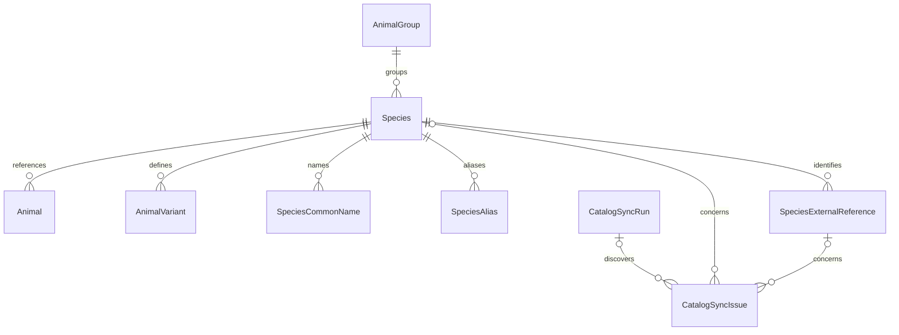

# Animal reference catalog metadata

Ticket 1 extends Professor in place. External providers supply data; CritterOps owns
Species identity. `Species.Id` remains an integer primary key, independent of every
provider's string identifiers. Existing Animal, AnimalGroup, AnimalVariant, DTOs,
endpoints, legacy text and fixed catalog seeds are unchanged.

## Species and ownership

Species retains IsActive and adds TaxonomicStatus (Unresolved, Accepted, Synonym,
Deprecated, Doubtful), IsManuallyManaged, CreatedAt, UpdatedAt and LastSyncedAt.
Internal enums are persisted as bounded strings. Existing records default to
Unresolved and manually managed, without reclassification. Historical creation and
modification timestamps remain null because their actual values are unknown.

IsManuallyManaged is conservative record-level protection: future writers must not
replace curated core values on protected species. Imported species explicitly set
it false; a manual core edit must set it true. Mixed ownership is represented by a
protected core record and separately retained provider observations. No field-level
merge or enforcement service is introduced. Future writers own this policy.

All timestamps use PostgreSQL timestamptz and UTC DateTime values. New name, alias,
reference and issue CreatedAt values default to CURRENT_TIMESTAMP. Species dates
are writer-supplied; LastSyncedAt means the last successful species synchronization.
ExternalReference.LastCheckedAt records an attempted check, even without changes;
UpdatedAt records the last change to the provider observation, not each check.
There is no automatic timestamp update or synchronization logic.

## Names, synonyms and provenance

Species.CommonName remains the only primary display-name authority. CommonNames
stores additional names with optional language and source attribution. No preferred
flag or cache duplicates that authority. Promoting an additional name is a future
writer operation: update CommonName explicitly, optionally retain the former display
name as an additional name, and remove a redundant additional entry in the same
transaction. Existing APIs continue to use CommonName; migration does not copy it.

SpeciesAlias associates an alternate, historical, synonym or deprecated scientific
name with the internal species it resolves to. It does not create another Species.
Source is optional free-text attribution (for example a provider slug, dataset
citation or museum); manual names do not require a provider. Provider synonym
observations can also retain ExternalAcceptedIdentifier, without an FK or requiring
that accepted taxon to have been imported. Its provider/dataset scope is the same as
the external reference unless a future adapter explicitly interprets otherwise.

Database-generated NameKey, LanguageKey and SourceKey use lower/btrim; blank optional
language/source keys are treated as null. The original strings are preserved.
Common-name uniqueness is (SpeciesId, NameKey, LanguageKey, SourceKey); alias
uniqueness is (SpeciesId, NameKey, AliasType, SourceKey). NULLS NOT DISTINCT closes
null-key duplication gaps. Different sources/languages and different species can
share names. Normalization follows the database locale; it is not accent folding.

## Provider and dataset identity

Provider is an extensible canonical lowercase slug, enforced by the same check on
references, runs and issues (`gbif`, `catalogue-of-life`, `ncbi`). There is no provider
enum/table and adding a provider requires no schema migration. Adapters must use one
agreed slug consistently; the database cannot detect semantically equivalent slugs.

DatasetIdentifier is nullable, bounded to 300 characters, nonblank and trimmed when
present. ExternalIdentifier is a required nonblank trimmed string, also bounded to
300. Both are case-sensitive opaque identifiers. Do not lowercase provider IDs.
External scientific name (500), provider status (200) and accepted identifier (300)
are stored separately from curated Species. Unknown provider statuses are retained
verbatim within these bounds rather than converted into the internal enum. Writers
must report overlength inputs as issues rather than silently truncate them.

A unique (Provider, DatasetIdentifier, ExternalIdentifier) index uses PostgreSQL
NULLS NOT DISTINCT. One external record cannot belong to conflicting internal
species, including when the dataset is unknown. Multiple datasets and providers
may reuse identifiers. This requires PostgreSQL 15+; the repository uses PostgreSQL
16 and its existing Npgsql 10.0.3 supports the mapping. No dependency upgrades.

## Sync history and issues

CatalogSyncRun records provider/dataset, operation (Import, Synchronization,
Validation, CatalogExpansion), lifecycle status (Pending, Running, Completed,
CompletedWithIssues, Failed, Cancelled), nullable StartedAt/CompletedAt, nonnegative
processed/created/updated/skipped/failed counts and optional bounded ErrorMessage.
Pending runs can exist before starting. Completion cannot precede starting.
Counts are writer-maintained summaries, not constrained to sum during incremental
updates. Retry attempts can use new runs; no checkpoint/resume protocol is defined.

CatalogSyncIssue records extensible IssueType (100), severity (Information, Warning,
Error), status (Open, Investigating, Resolved, Ignored), Description (4000), CreatedAt
and optional ResolvedAt. Run, species and reference FKs are optional so unmatched
records and manually discovered issues are representable. Provider, dataset and
external identifier preserve issue provenance after metadata removal. Writers must
copy consistent provenance when linking a run/reference and maintain lifecycle
transitions/resolution times; those cross-record policies are not automated here.
No raw API response, credential storage, reconciliation or retry workflow is added.

## Relationships, deletion and indexes

All new records have generated integer keys. Species children use required SpeciesId
FKs with cascade deletion. Existing Animals and variants restrict Species deletion,
so external metadata cannot delete Animals. Issue species/reference FKs use SET NULL
to retain history. An issue's run FK uses RESTRICT so referenced runs cannot be
removed accidentally. Deleting species metadata never deletes a run or issue.

Existing group/scientific-name composite and trigram search indexes are retained.
New name-key indexes support exact normalized lookup; species-leading unique indexes
also support collection lookup. References have the provider/dataset/identifier
unique index and a SpeciesId FK index. Runs index (Provider, StartedAt) and
(Status, StartedAt). Issues index each FK and (Status, IssueType) for review queues.
No low-selectivity standalone taxonomy-status index or new search service is added.

## Migration and verification

`20261017184321_ExpandAnimalReferenceCatalog` adds five Species columns and creates
SpeciesCommonNames, SpeciesAliases, SpeciesExternalReferences, CatalogSyncRuns and
CatalogSyncIssues. It leaves old columns, IDs, names, FKs and sequences intact.
Seed updates only initialize newly added fields; fixed seed identities and names
are unchanged. Reapplying migrations does not duplicate seed data.

Down drops the five new tables and five added columns. It preserves preexisting
catalog/animal data but **destroys newly introduced catalog metadata and history**.
Take an appropriate backup before a production rollback. Tests use disposable
PostgreSQL databases, never the development Professor database.

CatalogMetadataIntegrationTests covers real persistence, null-aware uniqueness,
case-normalized names, provider statuses, aliases, run/issue lifecycle, FK deletion,
and migration/down/reapply with structured, custom and legacy Animals. Its snapshot
compares every old Animal, group, variant and Species field across migration stages.
Existing catalog tests continue to validate API compatibility and seeded behavior.

## Follow-up boundaries

- Ticket 2: migrate legacy Animals using stable internal IDs; preserve custom text.
- Ticket 3: worker writes this schema and enforces curation, provenance and timestamps.
- Ticket 4: GBIF adapter maps opaque IDs/datasets and preserves raw provider statuses.
- Ticket 5: synchronization establishes merge, retry/checkpoint and issue policies;
  checkpoint persistence may need a later schema addition once the protocol is known.
- Ticket 6: multiple variant assignments remain a separate relationship migration.
- Ticket 7: extend search to names/aliases and measure indexes against actual queries.
- Ticket 8: document operational retention, provider slug registry, backup and recovery.

No worker, external calls, scheduler, API/frontend changes or deployment changes are
part of this ticket.
